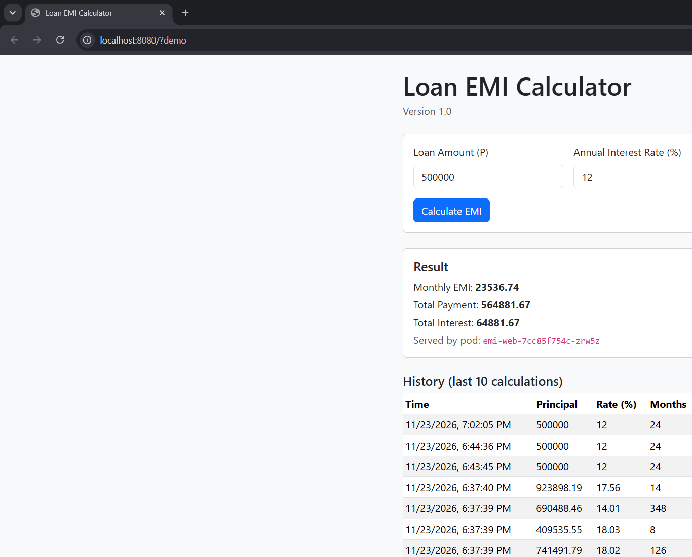
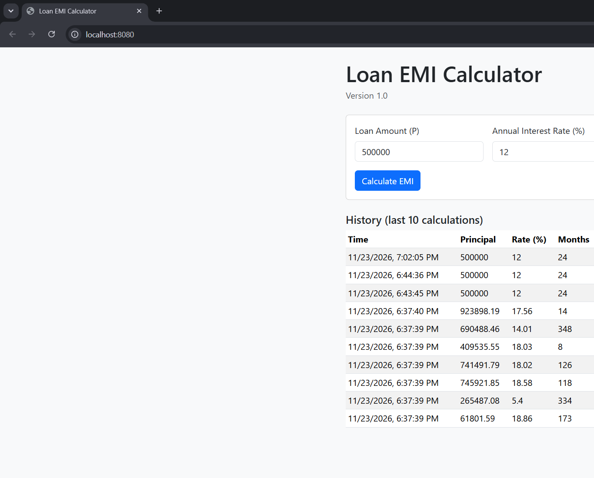
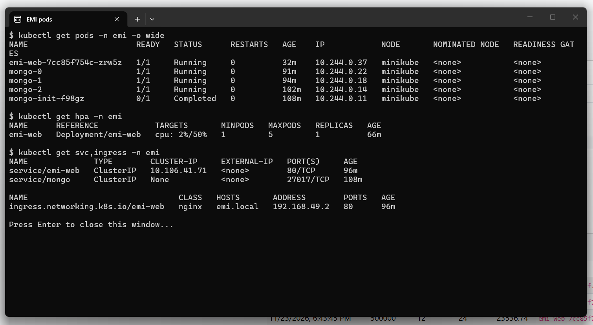
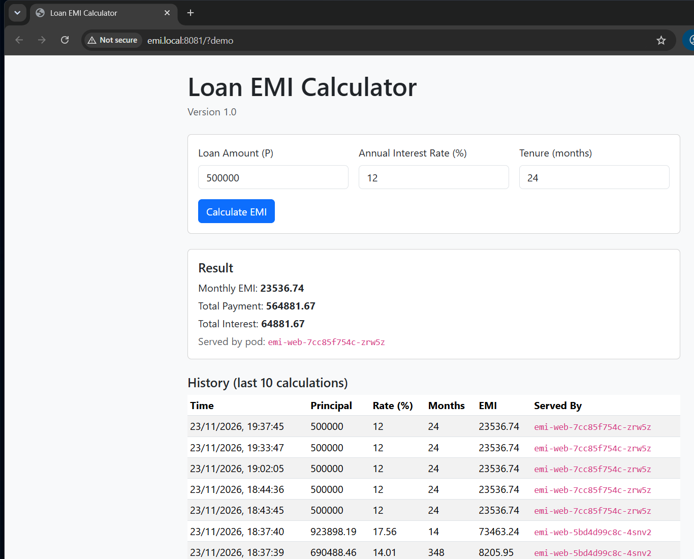
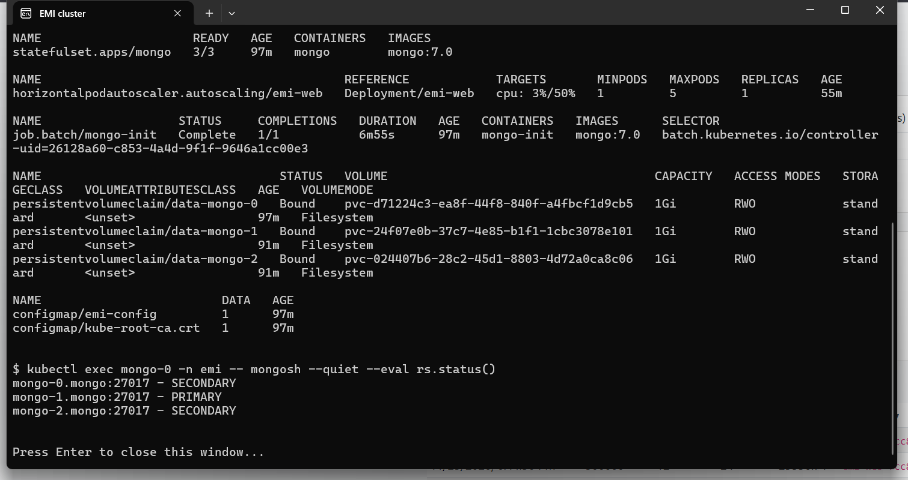
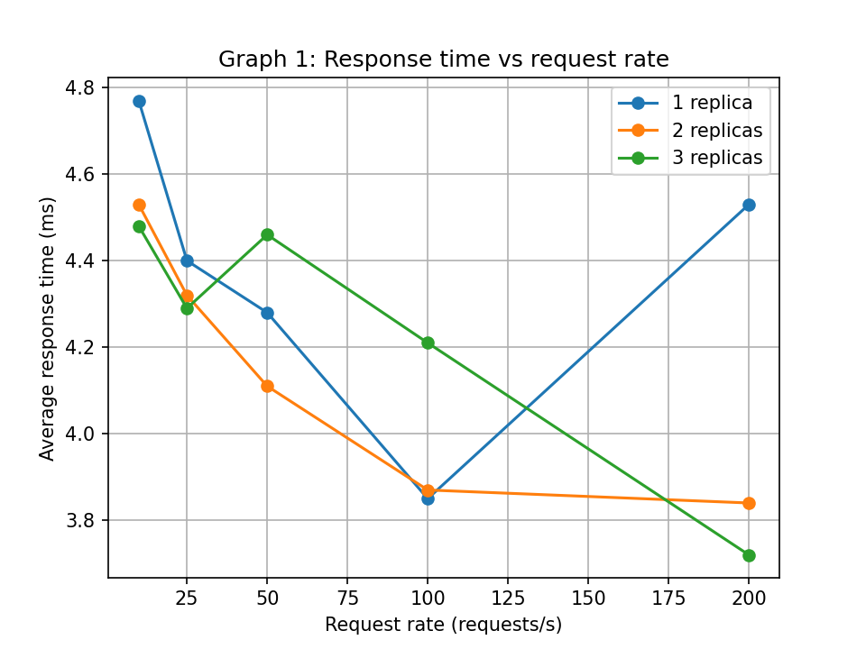
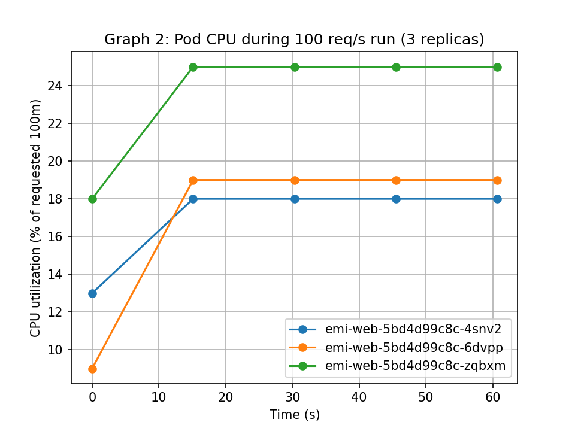
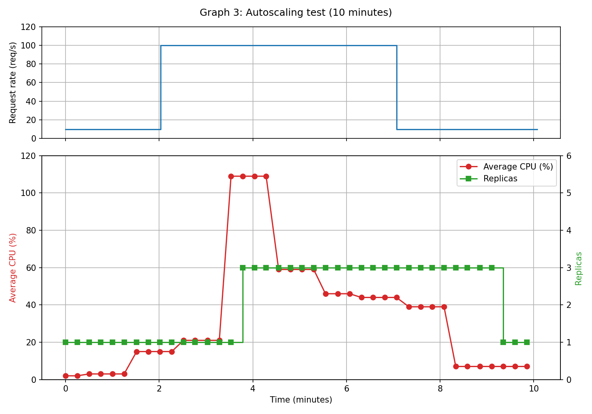

# Assignment 4: Deploying, Load Balancing and Autoscaling a Web Application with MongoDB on Kubernetes

**Roll No:** MSDSF26M001
**Git repository:** <paste repo link here>

---

## Milestone 01: Loan EMI Calculator with MongoDB

The app is built with **Node.js/Express**. The UI is a single page using Bootstrap and jQuery; the form is submitted with AJAX (no postback), so only the result panel and history table update.

- `POST /api/emi` - validates inputs, computes the EMI, saves to MongoDB, returns the result with the pod name (`HOSTNAME` env var)
- `GET /api/history` - last 10 calculations, newest first
- `GET /health` - HTTP 200 only when MongoDB is reachable (readiness probe)
- MongoDB connection string comes only from the `MONGO_URL` environment variable

**Screenshot: UI with result for P=500000, rate=12%, n=24, and the history table**



### app/server.js
```javascript
// Loan EMI Calculator - simple Express server with MongoDB storage
const express = require("express");
const { MongoClient } = require("mongodb");

const app = express();
const PORT = process.env.PORT || 3000;
const MONGO_URL = process.env.MONGO_URL || "mongodb://localhost:27017/emidb";
const POD_NAME = process.env.HOSTNAME || "unknown";

app.use(express.json());
app.use(express.static("public"));

let db = null;

// ---- EMI formula: P * r * (1+r)^n / ((1+r)^n - 1) ----
function computeEMI(principal, annualRate, months) {
  const r = annualRate / 12 / 100; // monthly interest rate
  const factor = Math.pow(1 + r, months);
  const emi = r === 0 ? principal / months : (principal * r * factor) / (factor - 1);
  const totalPayment = emi * months;
  return {
    emi: +emi.toFixed(2),
    totalPayment: +totalPayment.toFixed(2),
    totalInterest: +(totalPayment - principal).toFixed(2),
  };
}

// POST /api/emi  { principal, rate, months }
app.post("/api/emi", async (req, res) => {
  const p = Number(req.body.principal);
  const rate = Number(req.body.rate);
  const n = Number(req.body.months);

  // server-side validation: positive numbers only
  if (!(p > 0) || !(rate > 0) || !(n > 0)) {
    return res.status(400).json({ error: "All inputs must be positive numbers." });
  }

  const result = computeEMI(p, rate, n);
  const doc = {
    principal: p,
    rate: rate,
    months: n,
    emi: result.emi,
    servedBy: POD_NAME,
    createdAt: new Date(),
  };
  await db.collection("calculations").insertOne(doc);

  res.json({ ...result, servedBy: POD_NAME });
});

// GET /api/history - last 10 calculations, newest first
app.get("/api/history", async (req, res) => {
  const docs = await db
    .collection("calculations")
    .find({}, { projection: { _id: 0 } })
    .sort({ createdAt: -1 })
    .limit(10)
    .toArray();
  res.json(docs);
});

// GET /health - 200 only when MongoDB is reachable (used as readiness probe)
app.get("/health", async (req, res) => {
  try {
    await db.command({ ping: 1 });
    res.status(200).send("OK");
  } catch (e) {
    res.status(503).send("MongoDB not reachable");
  }
});

// Connect to MongoDB, then start listening
MongoClient.connect(MONGO_URL)
  .then((client) => {
    db = client.db(); // database name comes from the connection string
    app.listen(PORT, () => console.log(`EMI app listening on port ${PORT}`));
  })
  .catch((err) => {
    console.error("Failed to connect to MongoDB:", err);
    process.exit(1);
  });
```

### app/public/index.html
```html
<!DOCTYPE html>
<html lang="en">
<head>
  <meta charset="UTF-8" />
  <meta name="viewport" content="width=device-width, initial-scale=1" />
  <title>Loan EMI Calculator</title>
  <link href="https://cdn.jsdelivr.net/npm/bootstrap@5.3.3/dist/css/bootstrap.min.css" rel="stylesheet" />
  <script src="https://code.jquery.com/jquery-3.7.1.min.js"></script>
</head>
<body class="bg-light">
  <div class="container py-4" style="max-width: 800px;">
    <h1 class="mb-1">Loan EMI Calculator</h1>
    <p class="text-muted mb-4">Version 1.0</p>

    <div class="card mb-4">
      <div class="card-body">
        <form id="emiForm">
          <div class="row g-3">
            <div class="col-md-4">
              <label class="form-label">Loan Amount (P)</label>
              <input type="number" class="form-control" id="principal" min="1" step="any" value="500000" required />
            </div>
            <div class="col-md-4">
              <label class="form-label">Annual Interest Rate (%)</label>
              <input type="number" class="form-control" id="rate" min="0.01" step="any" value="12" required />
            </div>
            <div class="col-md-4">
              <label class="form-label">Tenure (months)</label>
              <input type="number" class="form-control" id="months" min="1" step="1" value="24" required />
            </div>
          </div>
          <button type="submit" class="btn btn-primary mt-3">Calculate EMI</button>
        </form>
      </div>
    </div>

    <div id="resultPanel" class="card mb-4 d-none">
      <div class="card-body">
        <h5 class="card-title">Result</h5>
        <p class="mb-1">Monthly EMI: <strong id="emi"></strong></p>
        <p class="mb-1">Total Payment: <strong id="totalPayment"></strong></p>
        <p class="mb-1">Total Interest: <strong id="totalInterest"></strong></p>
        <p class="mb-0 text-muted">Served by pod: <code id="servedBy"></code></p>
      </div>
    </div>
    <div id="errorPanel" class="alert alert-danger d-none"></div>

    <h5>History (last 10 calculations)</h5>
    <table class="table table-striped table-sm bg-white">
      <thead>
        <tr>
          <th>Time</th><th>Principal</th><th>Rate (%)</th><th>Months</th><th>EMI</th><th>Served By</th>
        </tr>
      </thead>
      <tbody id="historyBody"></tbody>
    </table>
  </div>

  <script>
    function loadHistory() {
      $.getJSON("/api/history", function (rows) {
        $("#historyBody").empty();
        rows.forEach(function (r) {
          $("#historyBody").append(
            "<tr><td>" + new Date(r.createdAt).toLocaleString() + "</td>" +
            "<td>" + r.principal + "</td>" +
            "<td>" + r.rate + "</td>" +
            "<td>" + r.months + "</td>" +
            "<td>" + r.emi + "</td>" +
            "<td><code>" + r.servedBy + "</code></td></tr>"
          );
        });
      });
    }

    // AJAX submit - no page reload, only result panel and history update
    $("#emiForm").on("submit", function (e) {
      e.preventDefault();
      var data = {
        principal: $("#principal").val(),
        rate: $("#rate").val(),
        months: $("#months").val(),
      };
      $.ajax({
        url: "/api/emi",
        method: "POST",
        contentType: "application/json",
        data: JSON.stringify(data),
        success: function (res) {
          $("#errorPanel").addClass("d-none");
          $("#resultPanel").removeClass("d-none");
          $("#emi").text(res.emi);
          $("#totalPayment").text(res.totalPayment);
          $("#totalInterest").text(res.totalInterest);
          $("#servedBy").text(res.servedBy);
          loadHistory();
        },
        error: function (xhr) {
          $("#resultPanel").addClass("d-none");
          $("#errorPanel").removeClass("d-none")
            .text(xhr.responseJSON ? xhr.responseJSON.error : "Request failed");
        },
      });
    });

    loadHistory();

    // open with ?demo to auto-submit the default form once (handy for screenshots)
    if (location.search.indexOf("demo") !== -1) $("#emiForm").submit();
  </script>
</body>
</html>
```

### app/package.json
```json
{
  "name": "emi-web",
  "version": "1.0.0",
  "description": "Loan EMI Calculator with MongoDB storage",
  "main": "server.js",
  "scripts": {
    "start": "node server.js"
  },
  "dependencies": {
    "express": "^4.19.2",
    "mongodb": "^6.8.0"
  }
}
```

---

## Milestone 02: Deploy MongoDB and the Web App on Minikube

### app/Dockerfile
```dockerfile
# Loan EMI Calculator - simple Dockerfile
FROM node:20-alpine

WORKDIR /app

# Install dependencies first (better layer caching)
COPY package.json ./
RUN npm install --omit=dev

# Copy application code
COPY server.js ./
COPY public ./public

# Run as the built-in non-root "node" user
USER node

EXPOSE 3000
CMD ["node", "server.js"]
```

### app/.dockerignore
```text
node_modules
npm-debug.log
Dockerfile
.dockerignore
.git
```

### k8s/00-namespace.yaml
```yaml
apiVersion: v1
kind: Namespace
metadata:
  name: emi
```

### k8s/01-mongo.yaml (headless Service + StatefulSet + init Job)
```yaml
# MongoDB replica set: headless Service + StatefulSet (3 members) + init Job
---
apiVersion: v1
kind: Service
metadata:
  name: mongo
  namespace: emi
spec:
  clusterIP: None        # headless service -> stable DNS names like mongo-0.mongo
  selector:
    app: mongo
  ports:
    - port: 27017
---
apiVersion: apps/v1
kind: StatefulSet
metadata:
  name: mongo
  namespace: emi
spec:
  serviceName: mongo
  replicas: 3
  selector:
    matchLabels:
      app: mongo
  template:
    metadata:
      labels:
        app: mongo
    spec:
      containers:
        - name: mongo
          image: mongo:7.0
          args: ["--replSet", "rs0", "--bind_ip_all"]
          ports:
            - containerPort: 27017
          volumeMounts:
            - name: data
              mountPath: /data/db
  # each pod gets its own 1Gi persistent volume
  volumeClaimTemplates:
    - metadata:
        name: data
      spec:
        accessModes: ["ReadWriteOnce"]
        storageClassName: standard
        resources:
          requests:
            storage: 1Gi
---
apiVersion: batch/v1
kind: Job
metadata:
  name: mongo-init
  namespace: emi
spec:
  template:
    spec:
      restartPolicy: Never
      containers:
        - name: mongo-init
          image: mongo:7.0
          # wait for mongo-0, then initiate the replica set (idempotent)
          command: ["sh", "-c"]
          args:
            - |
              until mongosh --host mongo-0.mongo:27017 --quiet --eval '
                try {
                  if (rs.status().ok) { quit(0); }
                } catch (e) {
                  rs.initiate({ _id: "rs0", members: [
                    { _id: 0, host: "mongo-0.mongo:27017" },
                    { _id: 1, host: "mongo-1.mongo:27017" },
                    { _id: 2, host: "mongo-2.mongo:27017" }
                  ]});
                }'; do
                echo "waiting for mongod..."; sleep 5;
              done
              echo "Replica set rs0 is ready:"
              mongosh --host mongo-0.mongo:27017 --quiet --eval 'rs.status().members.forEach(m => print(m.name, m.stateStr))'
```

### k8s/02-configmap.yaml
```yaml
# MongoDB connection string for the web pods (no credentials, so ConfigMap is fine)
apiVersion: v1
kind: ConfigMap
metadata:
  name: emi-config
  namespace: emi
data:
  MONGO_URL: "mongodb://mongo-0.mongo:27017,mongo-1.mongo:27017,mongo-2.mongo:27017/emidb?replicaSet=rs0"
```

### k8s/03-web.yaml (Deployment + ClusterIP Service)
```yaml
# Web application: Deployment (3 replicas) + ClusterIP Service
---
apiVersion: apps/v1
kind: Deployment
metadata:
  name: emi-web
  namespace: emi
spec:
  replicas: 3
  selector:
    matchLabels:
      app: emi-web
  template:
    metadata:
      labels:
        app: emi-web
    spec:
      containers:
        - name: emi-web
          image: emi-web:1.0
          imagePullPolicy: IfNotPresent
          ports:
            - containerPort: 3000
          env:
            - name: MONGO_URL
              valueFrom:
                configMapKeyRef:
                  name: emi-config
                  key: MONGO_URL
          readinessProbe:
            httpGet: { path: /health, port: 3000 }
            periodSeconds: 5
          livenessProbe:
            httpGet: { path: /health, port: 3000 }
            periodSeconds: 10
          resources:
            requests:
              cpu: 100m
              memory: 128Mi
            limits:
              cpu: 250m
              memory: 256Mi
---
apiVersion: v1
kind: Service
metadata:
  name: emi-web
  namespace: emi
spec:
  type: ClusterIP
  selector:
    app: emi-web
  ports:
    - port: 80
      targetPort: 3000
```

### Output: kubectl get all,pvc,configmap -n emi -o wide (all pods Running and Ready)
```text
NAME                           READY   STATUS      RESTARTS   AGE     IP            NODE       NOMINATED NODE   READINESS GATES
pod/emi-web-5bd4d99c8c-cdtrw   1/1     Running     0          75s     10.244.0.15   minikube   <none>           <none>
pod/emi-web-5bd4d99c8c-fdgc6   1/1     Running     0          75s     10.244.0.17   minikube   <none>           <none>
pod/emi-web-5bd4d99c8c-xc57w   1/1     Running     0          75s     10.244.0.16   minikube   <none>           <none>
pod/mongo-0                    1/1     Running     0          13m     10.244.0.12   minikube   <none>           <none>
pod/mongo-1                    1/1     Running     0          6m58s   10.244.0.13   minikube   <none>           <none>
pod/mongo-2                    1/1     Running     0          6m57s   10.244.0.14   minikube   <none>           <none>
pod/mongo-init-f98gz           0/1     Completed   0          13m     10.244.0.11   minikube   <none>           <none>

NAME              TYPE        CLUSTER-IP     EXTERNAL-IP   PORT(S)     AGE   SELECTOR
service/emi-web   ClusterIP   10.106.41.71   <none>        80/TCP      75s   app=emi-web
service/mongo     ClusterIP   None           <none>        27017/TCP   13m   app=mongo

NAME                      READY   UP-TO-DATE   AVAILABLE   AGE   CONTAINERS   IMAGES        SELECTOR
deployment.apps/emi-web   3/3     3            3           75s   emi-web      emi-web:1.0   app=emi-web

NAME                                 DESIRED   CURRENT   READY   AGE   CONTAINERS   IMAGES        SELECTOR
replicaset.apps/emi-web-5bd4d99c8c   3         3         3       75s   emi-web      emi-web:1.0   app=emi-web,pod-template-hash=5bd4d99c8c

NAME                     READY   AGE   CONTAINERS   IMAGES
statefulset.apps/mongo   3/3     13m   mongo        mongo:7.0

NAME                   STATUS     COMPLETIONS   DURATION   AGE   CONTAINERS   IMAGES      SELECTOR
job.batch/mongo-init   Complete   1/1           6m55s      13m   mongo-init   mongo:7.0   batch.kubernetes.io/controller-uid=26128a60-c853-4a4d-9f1f-9646a1cc00e3

NAME                                 STATUS   VOLUME                                     CAPACITY   ACCESS MODES   STORAGECLASS   VOLUMEATTRIBUTESCLASS   AGE     VOLUMEMODE
persistentvolumeclaim/data-mongo-0   Bound    pvc-d71224c3-ea8f-44f8-840f-a4fbcf1d9cb5   1Gi        RWO            standard       <unset>                 13m     Filesystem
persistentvolumeclaim/data-mongo-1   Bound    pvc-24f07e0b-37c7-4e85-b1f1-1cbc3078e101   1Gi        RWO            standard       <unset>                 6m58s   Filesystem
persistentvolumeclaim/data-mongo-2   Bound    pvc-024407b6-28c2-45d1-8803-4d72a0ca8c06   1Gi        RWO            standard       <unset>                 6m57s   Filesystem

NAME                         DATA   AGE
configmap/emi-config         1      13m
configmap/kube-root-ca.crt   1      13m
```

### Output: mongo-init job logs and rs.status() (trimmed)
```text
{ ok: 1 }
Replica set rs0 is ready:
mongo-0.mongo:27017 SECONDARY
mongo-1.mongo:27017 STARTUP
mongo-2.mongo:27017 STARTUP

--- rs.status() (trimmed) ---
mongo-0.mongo:27017 - PRIMARY
mongo-1.mongo:27017 - SECONDARY
mongo-2.mongo:27017 - SECONDARY
```

**Screenshot: app through `kubectl port-forward svc/emi-web 8080:80 -n emi` with the history table**



**Screenshot: terminal showing pods Running, HPA, Services and Ingress**



### Persistence test: delete pod mongo-1
**Before (document count, pod, PVC):**
```text
=== documents BEFORE deleting mongo-1 ===
4
=== mongo-1 pod and its PVC BEFORE ===
NAME      READY   STATUS    RESTARTS   AGE     IP            NODE       NOMINATED NODE   READINESS GATES
mongo-1   1/1     Running   0          7m10s   10.244.0.13   minikube   <none>           <none>
NAME           STATUS   VOLUME                                     CAPACITY   ACCESS MODES   STORAGECLASS   VOLUMEATTRIBUTESCLASS   AGE
data-mongo-1   Bound    pvc-24f07e0b-37c7-4e85-b1f1-1cbc3078e101   1Gi        RWO            standard       <unset>                 7m10s
=== deleting mongo-1 ===
pod "mongo-1" deleted from emi namespace
```

**After (pod re-created with same name and same PVC, no data loss):**
```text
=== mongo-1 AFTER re-creation (same name, same PVC, fresh age) ===
pod/mongo-1 condition met
NAME      READY   STATUS    RESTARTS   AGE   IP            NODE       NOMINATED NODE   READINESS GATES
mongo-1   1/1     Running   0          29s   10.244.0.18   minikube   <none>           <none>
NAME           STATUS   VOLUME                                     CAPACITY   ACCESS MODES   STORAGECLASS   VOLUMEATTRIBUTESCLASS   AGE
data-mongo-1   Bound    pvc-24f07e0b-37c7-4e85-b1f1-1cbc3078e101   1Gi        RWO            standard       <unset>                 7m56s
=== documents AFTER (no data loss) ===
4
```

---

## Milestone 03: Ingress, Load Balancing and Self-Healing

### k8s/04-ingress.yaml
```yaml
# NGINX Ingress: http://emi.local/ -> emi-web service
apiVersion: networking.k8s.io/v1
kind: Ingress
metadata:
  name: emi-web
  namespace: emi
spec:
  ingressClassName: nginx
  rules:
    - host: emi.local
      http:
        paths:
          - path: /
            pathType: Prefix
            backend:
              service:
                name: emi-web
                port:
                  number: 80
```

**Screenshot: app at http://emi.local through the NGINX Ingress**



### Load distribution: 30 requests, servedBy count
**3 replicas:**
```text
     10 emi-web-5bd4d99c8c-cdtrw
      8 emi-web-5bd4d99c8c-fdgc6
     12 emi-web-5bd4d99c8c-xc57w
```

**5 replicas (after kubectl scale --replicas=5; new pods get traffic only when Ready):**
```text
      5 emi-web-5bd4d99c8c-929jb
      6 emi-web-5bd4d99c8c-cdtrw
      8 emi-web-5bd4d99c8c-fdgc6
      5 emi-web-5bd4d99c8c-tvdtm
      6 emi-web-5bd4d99c8c-xc57w
```

### Self-healing 1: delete one web pod (app keeps answering through the Ingress)

Pod watch during the delete (new pod created automatically):
```text
NAME                       READY   STATUS      RESTARTS   AGE
emi-web-5bd4d99c8c-929jb   1/1     Running     0          48s
emi-web-5bd4d99c8c-cdtrw   1/1     Running     0          3m40s
emi-web-5bd4d99c8c-fdgc6   1/1     Running     0          3m40s
emi-web-5bd4d99c8c-tvdtm   1/1     Running     0          48s
emi-web-5bd4d99c8c-xc57w   1/1     Running     0          3m40s
mongo-0                    1/1     Running     0          16m
mongo-1                    1/1     Running     0          117s
mongo-2                    1/1     Running     0          9m22s
mongo-init-f98gz           0/1     Completed   0          16m
emi-web-5bd4d99c8c-929jb   1/1     Terminating   0          53s
emi-web-5bd4d99c8c-w2mxp   0/1     Pending       0          0s
emi-web-5bd4d99c8c-929jb   1/1     Terminating   0          53s
emi-web-5bd4d99c8c-w2mxp   0/1     Pending       0          0s
emi-web-5bd4d99c8c-w2mxp   0/1     ContainerCreating   0          0s
emi-web-5bd4d99c8c-w2mxp   0/1     ContainerCreating   0          1s
emi-web-5bd4d99c8c-w2mxp   0/1     Running             0          1s
emi-web-5bd4d99c8c-w2mxp   1/1     Running             0          7s
emi-web-5bd4d99c8c-w2mxp   1/1     Running             0          7s
emi-web-5bd4d99c8c-929jb   0/1     Error               0          84s
emi-web-5bd4d99c8c-929jb   0/1     Error               0          84s
emi-web-5bd4d99c8c-929jb   0/1     Error               0          84s
emi-web-5bd4d99c8c-929jb   0/1     Error               0          84s
mongo-0                    1/1     Terminating         0          17m
mongo-0                    1/1     Terminating         0          17m
mongo-0                    0/1     Completed           0          17m
mongo-0                    0/1     Completed           0          17m
mongo-0                    0/1     Completed           0          17m
mongo-0                    0/1     Pending             0          0s
mongo-0                    0/1     Pending             0          0s
mongo-0                    0/1     ContainerCreating   0          0s
mongo-0                    0/1     ContainerCreating   0          0s
mongo-0                    1/1     Running             0          0s
emi-web-66b9655658-4ck44   0/1     Pending             0          0s
emi-web-66b9655658-546pc   0/1     Pending             0          0s
emi-web-66b9655658-4ck44   0/1     Pending             0          0s
emi-web-5bd4d99c8c-w2mxp   1/1     Terminating         0          2m7s
emi-web-66b9655658-546pc   0/1     Pending             0          0s
emi-web-5bd4d99c8c-w2mxp   1/1     Terminating         0          2m7s
emi-web-66b9655658-4ck44   0/1     ContainerCreating   0          0s
emi-web-66b9655658-frblq   0/1     Pending             0          0s
emi-web-66b9655658-frblq   0/1     Pending             0          0s
emi-web-66b9655658-546pc   0/1     ContainerCreating   0          0s
emi-web-66b9655658-frblq   0/1     ContainerCreating   0          0s
emi-web-66b9655658-546pc   0/1     ContainerCreating   0          1s
emi-web-66b9655658-4ck44   0/1     ContainerCreating   0          1s
emi-web-66b9655658-frblq   0/1     ContainerCreating   0          1s
emi-web-66b9655658-4ck44   0/1     Running             0          1s
emi-web-66b9655658-546pc   0/1     Running             0          1s
emi-web-66b9655658-frblq   0/1     Running             0          1s
emi-web-66b9655658-frblq   1/1     Running             0          6s
emi-web-66b9655658-frblq   1/1     Running             0          6s
emi-web-5bd4d99c8c-tvdtm   1/1     Terminating         0          3m6s
emi-web-66b9655658-4ck44   1/1     Running             0          6s
emi-web-66b9655658-546pc   1/1     Running             0          6s
emi-web-5bd4d99c8c-tvdtm   1/1     Terminating         0          3m6s
emi-web-5bd4d99c8c-cdtrw   1/1     Terminating         0          5m58s
emi-web-66b9655658-2kjvs   0/1     Pending             0          0s
emi-web-66b9655658-2kjvs   0/1     Pending             0          0s
emi-web-5bd4d99c8c-cdtrw   1/1     Terminating         0          5m58s
emi-web-5bd4d99c8c-fdgc6   1/1     Terminating         0          5m58s
emi-web-66b9655658-2k479   0/1     Pending             0          0s
emi-web-66b9655658-2kjvs   0/1     ContainerCreating   0          0s
emi-web-66b9655658-2k479   0/1     Pending             0          0s
emi-web-5bd4d99c8c-fdgc6   1/1     Terminating         0          5m58s
emi-web-66b9655658-2k479   0/1     ContainerCreating   0          0s
emi-web-66b9655658-2k479   0/1     ContainerCreating   0          0s
emi-web-66b9655658-2kjvs   0/1     ContainerCreating   0          0s
emi-web-66b9655658-2k479   0/1     Running             0          1s
emi-web-66b9655658-2kjvs   0/1     Running             0          1s
emi-web-66b9655658-2k479   1/1     Running             0          6s
emi-web-66b9655658-2kjvs   1/1     Running             0          6s
emi-web-66b9655658-2k479   1/1     Running             0          6s
emi-web-5bd4d99c8c-xc57w   1/1     Terminating         0          6m4s
emi-web-5bd4d99c8c-xc57w   1/1     Terminating         0          6m4s
emi-web-5bd4d99c8c-w2mxp   0/1     Error               0          2m37s
emi-web-5bd4d99c8c-w2mxp   0/1     Error               0          2m38s
emi-web-5bd4d99c8c-w2mxp   0/1     Error               0          2m38s
emi-web-5bd4d99c8c-tvdtm   0/1     Error               0          3m36s
emi-web-5bd4d99c8c-cdtrw   0/1     Error               0          6m28s
emi-web-5bd4d99c8c-fdgc6   0/1     Error               0          6m28s
emi-web-5bd4d99c8c-cdtrw   0/1     Error               0          6m29s
emi-web-5bd4d99c8c-cdtrw   0/1     Error               0          6m29s
emi-web-5bd4d99c8c-fdgc6   0/1     Error               0          6m29s
emi-web-5bd4d99c8c-fdgc6   0/1     Error               0          6m29s
emi-web-5bd4d99c8c-tvdtm   0/1     Error               0          3m37s
emi-web-5bd4d99c8c-tvdtm   0/1     Error               0          3m37s
emi-web-5bd4d99c8c-xc57w   0/1     Error               0          6m34s
emi-web-5bd4d99c8c-xc57w   0/1     Error               0          6m35s
emi-web-5bd4d99c8c-xc57w   0/1     Error               0          6m35s
emi-web-5bd4d99c8c-w2lsb   0/1     Pending             0          0s
emi-web-5bd4d99c8c-w2lsb   0/1     Pending             0          0s
emi-web-5bd4d99c8c-bcgp6   0/1     Pending             0          0s
emi-web-66b9655658-4ck44   1/1     Terminating         0          54s
emi-web-5bd4d99c8c-bcgp6   0/1     Pending             0          0s
emi-web-5bd4d99c8c-w2lsb   0/1     ContainerCreating   0          0s
emi-web-66b9655658-4ck44   1/1     Terminating         0          54s
emi-web-5bd4d99c8c-4snv2   0/1     Pending             0          0s
emi-web-5bd4d99c8c-4snv2   0/1     Pending             0          0s
emi-web-5bd4d99c8c-bcgp6   0/1     ContainerCreating   0          0s
emi-web-5bd4d99c8c-4snv2   0/1     ContainerCreating   0          0s
emi-web-5bd4d99c8c-bcgp6   0/1     ContainerCreating   0          1s
emi-web-5bd4d99c8c-bcgp6   0/1     Running             0          1s
emi-web-5bd4d99c8c-w2lsb   0/1     ContainerCreating   0          1s
emi-web-5bd4d99c8c-w2lsb   0/1     Running             0          1s
emi-web-5bd4d99c8c-4snv2   0/1     ContainerCreating   0          1s
emi-web-5bd4d99c8c-4snv2   0/1     Running             0          1s
emi-web-5bd4d99c8c-4snv2   1/1     Running             0          6s
emi-web-5bd4d99c8c-bcgp6   1/1     Running             0          6s
emi-web-66b9655658-2k479   1/1     Terminating         0          54s
emi-web-5bd4d99c8c-4snv2   1/1     Running             0          6s
emi-web-5bd4d99c8c-dmfd5   0/1     Pending             0          0s
emi-web-5bd4d99c8c-w2lsb   1/1     Running             0          6s
emi-web-5bd4d99c8c-dmfd5   0/1     Pending             0          0s
emi-web-66b9655658-2k479   1/1     Terminating         0          54s
emi-web-66b9655658-546pc   1/1     Terminating         0          60s
emi-web-5bd4d99c8c-dmfd5   0/1     ContainerCreating   0          0s
emi-web-5bd4d99c8c-6dcw4   0/1     Pending             0          0s
emi-web-66b9655658-546pc   1/1     Terminating         0          60s
emi-web-5bd4d99c8c-6dcw4   0/1     Pending             0          0s
emi-web-66b9655658-frblq   1/1     Terminating         0          60s
emi-web-5bd4d99c8c-6dcw4   0/1     ContainerCreating   0          0s
emi-web-66b9655658-frblq   1/1     Terminating         0          60s
emi-web-5bd4d99c8c-6dcw4   0/1     ContainerCreating   0          1s
emi-web-5bd4d99c8c-dmfd5   0/1     ContainerCreating   0          1s
emi-web-5bd4d99c8c-6dcw4   0/1     Running             0          1s
emi-web-5bd4d99c8c-dmfd5   0/1     Running             0          1s
emi-web-5bd4d99c8c-dmfd5   1/1     Running             0          6s
emi-web-5bd4d99c8c-6dcw4   1/1     Running             0          6s
emi-web-66b9655658-2kjvs   1/1     Terminating         0          60s
emi-web-5bd4d99c8c-dmfd5   1/1     Running             0          6s
emi-web-66b9655658-2kjvs   1/1     Terminating         0          60s
emi-web-66b9655658-4ck44   0/1     Error               0          84s
emi-web-66b9655658-4ck44   0/1     Error               0          85s
emi-web-66b9655658-4ck44   0/1     Error               0          85s
emi-web-66b9655658-2k479   0/1     Error               0          84s
emi-web-66b9655658-546pc   0/1     Error               0          90s
emi-web-66b9655658-frblq   0/1     Error               0          90s
emi-web-66b9655658-546pc   0/1     Error               0          91s
emi-web-66b9655658-546pc   0/1     Error               0          91s
emi-web-66b9655658-frblq   0/1     Error               0          91s
emi-web-66b9655658-frblq   0/1     Error               0          91s
emi-web-66b9655658-2k479   0/1     Error               0          85s
emi-web-66b9655658-2k479   0/1     Error               0          85s
emi-web-66b9655658-2kjvs   0/1     Error               0          90s
emi-web-66b9655658-2kjvs   0/1     Error               0          91s
emi-web-66b9655658-2kjvs   0/1     Error               0          91s
emi-web-5bd4d99c8c-dmfd5   1/1     Terminating         0          62s
emi-web-5bd4d99c8c-w2lsb   1/1     Terminating         0          68s
emi-web-5bd4d99c8c-bcgp6   1/1     Terminating         0          68s
emi-web-5bd4d99c8c-6dcw4   1/1     Terminating         0          62s
emi-web-5bd4d99c8c-w2lsb   1/1     Terminating         0          68s
emi-web-5bd4d99c8c-6dcw4   1/1     Terminating         0          62s
emi-web-5bd4d99c8c-dmfd5   1/1     Terminating         0          62s
emi-web-5bd4d99c8c-bcgp6   1/1     Terminating         0          68s
emi-web-5bd4d99c8c-6dcw4   0/1     Error               0          92s
emi-web-5bd4d99c8c-dmfd5   0/1     Error               0          92s
emi-web-5bd4d99c8c-w2lsb   0/1     Error               0          98s
emi-web-5bd4d99c8c-bcgp6   0/1     Error               0          98s
emi-web-5bd4d99c8c-6dcw4   0/1     Error               0          93s
emi-web-5bd4d99c8c-6dcw4   0/1     Error               0          93s
emi-web-5bd4d99c8c-bcgp6   0/1     Error               0          99s
emi-web-5bd4d99c8c-bcgp6   0/1     Error               0          99s
emi-web-5bd4d99c8c-dmfd5   0/1     Error               0          93s
emi-web-5bd4d99c8c-dmfd5   0/1     Error               0          93s
emi-web-5bd4d99c8c-w2lsb   0/1     Error               0          99s
emi-web-5bd4d99c8c-w2lsb   0/1     Error               0          99s
emi-web-5bd4d99c8c-6dvpp   0/1     Pending             0          0s
emi-web-5bd4d99c8c-6dvpp   0/1     Pending             0          0s
emi-web-5bd4d99c8c-6dvpp   0/1     ContainerCreating   0          0s
emi-web-5bd4d99c8c-6dvpp   0/1     ContainerCreating   0          0s
emi-web-5bd4d99c8c-6dvpp   0/1     Running             0          1s
emi-web-5bd4d99c8c-6dvpp   1/1     Running             0          6s
emi-web-5bd4d99c8c-6dvpp   1/1     Running             0          6s
emi-web-5bd4d99c8c-zqbxm   0/1     Pending             0          0s
emi-web-5bd4d99c8c-zqbxm   0/1     Pending             0          0s
emi-web-5bd4d99c8c-zqbxm   0/1     ContainerCreating   0          0s
emi-web-5bd4d99c8c-zqbxm   0/1     ContainerCreating   0          1s
emi-web-5bd4d99c8c-zqbxm   0/1     Running             0          1s
emi-web-5bd4d99c8c-zqbxm   1/1     Running             0          6s
emi-web-5bd4d99c8c-zqbxm   1/1     Running             0          6s
```

Request log during the delete - all 40 requests returned HTTP 200:
```text
17:41:36 request 1 -> HTTP 200
17:41:37 request 2 -> HTTP 200
17:41:37 request 3 -> HTTP 200
17:41:38 request 4 -> HTTP 200
17:41:38 request 5 -> HTTP 200
17:41:39 request 6 -> HTTP 200
17:41:39 request 7 -> HTTP 200
17:41:40 request 8 -> HTTP 200
17:41:40 request 9 -> HTTP 200
17:41:41 request 10 -> HTTP 200
17:41:41 request 11 -> HTTP 200
17:41:42 request 12 -> HTTP 200
17:41:42 request 13 -> HTTP 200
17:41:43 request 14 -> HTTP 200
17:41:43 request 15 -> HTTP 200
17:41:44 request 16 -> HTTP 200
17:41:44 request 17 -> HTTP 200
17:41:45 request 18 -> HTTP 200
17:41:45 request 19 -> HTTP 200
17:41:46 request 20 -> HTTP 200
17:41:46 request 21 -> HTTP 200
17:41:47 request 22 -> HTTP 200
17:41:47 request 23 -> HTTP 200
17:41:48 request 24 -> HTTP 200
17:41:49 request 25 -> HTTP 200
17:41:49 request 26 -> HTTP 200
17:41:50 request 27 -> HTTP 200
17:41:50 request 28 -> HTTP 200
17:41:51 request 29 -> HTTP 200
17:41:51 request 30 -> HTTP 200
17:41:52 request 31 -> HTTP 200
17:41:52 request 32 -> HTTP 200
17:41:53 request 33 -> HTTP 200
17:41:53 request 34 -> HTTP 200
17:41:54 request 35 -> HTTP 200
17:41:54 request 36 -> HTTP 200
17:41:55 request 37 -> HTTP 200
17:41:55 request 38 -> HTTP 200
17:41:56 request 39 -> HTTP 200
17:41:56 request 40 -> HTTP 200
```

### Self-healing 2: delete the MongoDB PRIMARY (mongo-0)

New PRIMARY elected (mongo-1), mongo-0 re-created as SECONDARY, app still saves:
```text
=== watch output (mongo pods) ===
NAME      READY   STATUS    RESTARTS   AGE
mongo-0   1/1     Running   0          17m
mongo-1   1/1     Running   0          2m44s
mongo-2   1/1     Running   0          10m
mongo-0   1/1     Terminating   0          17m
mongo-0   1/1     Terminating   0          17m
mongo-0   0/1     Completed     0          17m
mongo-0   0/1     Completed     0          17m
mongo-0   0/1     Completed     0          17m
mongo-0   0/1     Pending       0          0s
mongo-0   0/1     Pending       0          0s
mongo-0   0/1     ContainerCreating   0          0s
mongo-0   0/1     ContainerCreating   0          0s
mongo-0   1/1     Running             0          0s

=== rs.status() after failover ===
mongo-0.mongo:27017 - SECONDARY
mongo-1.mongo:27017 - PRIMARY
mongo-2.mongo:27017 - SECONDARY

=== app still saves (POST through ingress) ===
{"emi":8008.24,"totalPayment":288296.55,"totalInterest":38296.55,"servedBy":"emi-web-5bd4d99c8c-tvdtm"}
=== document count now ===
135
```

**Screenshot: StatefulSet, PVCs and rs.status() (mongo-1 PRIMARY after failover)**



### Rolling update (1.0 -> 1.1) and rollback

rollout status while a request loop was running:
```text
deployment.apps/emi-web image updated
Waiting for deployment "emi-web" rollout to finish: 3 out of 5 new replicas have been updated...
Waiting for deployment "emi-web" rollout to finish: 3 out of 5 new replicas have been updated...
Waiting for deployment "emi-web" rollout to finish: 3 out of 5 new replicas have been updated...
Waiting for deployment "emi-web" rollout to finish: 3 out of 5 new replicas have been updated...
Waiting for deployment "emi-web" rollout to finish: 3 out of 5 new replicas have been updated...
Waiting for deployment "emi-web" rollout to finish: 3 out of 5 new replicas have been updated...
Waiting for deployment "emi-web" rollout to finish: 4 out of 5 new replicas have been updated...
Waiting for deployment "emi-web" rollout to finish: 1 old replicas are pending termination...
Waiting for deployment "emi-web" rollout to finish: 1 old replicas are pending termination...
Waiting for deployment "emi-web" rollout to finish: 1 old replicas are pending termination...
deployment "emi-web" successfully rolled out
```

Request loop log during the update (zero failed requests):
```text
... (90 requests) ...
17:44:29 request 89 -> HTTP 200
17:44:30 request 90 -> HTTP 200
TOTAL FAILED REQUESTS: 0
```

rollout history, then rollback with kubectl rollout undo:
```text
deployment.apps/emi-web 
REVISION  CHANGE-CAUSE
1         <none>
2         <none>

```
```text
Warning: resource deployments/emi-web was previously managed with 'kubectl apply'. Rolling back will not update the kubectl.kubernetes.io/last-applied-configuration annotation, which may cause unexpected behavior on future 'kubectl apply' operations. Consider using 'kubectl apply' with your previous configuration file instead.
deployment.apps/emi-web rolled back
Waiting for deployment "emi-web" rollout to finish: 3 out of 5 new replicas have been updated...
Waiting for deployment "emi-web" rollout to finish: 3 out of 5 new replicas have been updated...
Waiting for deployment "emi-web" rollout to finish: 3 out of 5 new replicas have been updated...
Waiting for deployment "emi-web" rollout to finish: 3 out of 5 new replicas have been updated...
Waiting for deployment "emi-web" rollout to finish: 3 out of 5 new replicas have been updated...
Waiting for deployment "emi-web" rollout to finish: 4 out of 5 new replicas have been updated...
Waiting for deployment "emi-web" rollout to finish: 2 old replicas are pending termination...
Waiting for deployment "emi-web" rollout to finish: 1 old replicas are pending termination...
Waiting for deployment "emi-web" rollout to finish: 1 old replicas are pending termination...
Waiting for deployment "emi-web" rollout to finish: 1 old replicas are pending termination...
deployment "emi-web" successfully rolled out
deployment.apps/emi-web 
REVISION  CHANGE-CAUSE
2         <none>
3         <none>

```

---

## Milestone 04: Load Testing, Profiling and Autoscaling

Workload: `POST /api/emi` with random valid inputs through the Ingress (`scripts/loadgen.py`). 15 fixed-replica runs (rates 10/25/50/100/200 req/s x 1/2/3 replicas, 60 s each) - **zero errors in all runs**. Per-pod CPU/memory sampled every 15 s and host CPU every 1 s (`scripts/monitor.py`). All raw CSVs are in `results/`.

### Summary of the 15 fixed runs
```text
replicas,rate,requests,errors,avg_latency_ms
1,10,600,0,4.77
1,25,1500,0,4.40
1,50,3000,0,4.28
1,100,6000,0,3.85
1,200,12000,0,4.53
2,10,600,0,4.53
2,25,1500,0,4.32
2,50,3000,0,4.11
2,100,6000,0,3.87
2,200,12000,0,3.84
3,10,600,0,4.48
3,25,1500,0,4.29
3,50,3000,0,4.46
3,100,6000,0,4.21
3,200,12000,0,3.72
```

### Graph 1: Average response time vs request rate (1, 2, 3 replicas)



### Graph 2: Per-pod CPU during the 100 req/s run with 3 replicas



### Autoscaling test: k8s/05-hpa.yaml
```yaml
# Horizontal Pod Autoscaler: 1-5 pods at 50% average CPU
apiVersion: autoscaling/v2
kind: HorizontalPodAutoscaler
metadata:
  name: emi-web
  namespace: emi
spec:
  scaleTargetRef:
    apiVersion: apps/v1
    kind: Deployment
    name: emi-web
  minReplicas: 1
  maxReplicas: 5
  metrics:
    - type: Resource
      resource:
        name: cpu
        target:
          type: Utilization
          averageUtilization: 50
  behavior:
    scaleDown:
      # shorter than the default 5 min so the scale-down is visible
      # during the 3-minute cool-down phase of the Milestone 4 test
      stabilizationWindowSeconds: 60
```

10-minute test: 2 min @ 10 req/s, 5 min @ 100 req/s, 3 min @ 10 req/s. The HPA scaled the Deployment 1 -> 3 pods when CPU crossed 50%, and back to 1 during cool-down.

### Graph 3: request rate, average CPU and replica count over the 10 minutes



### HPA timeline (kubectl get hpa every 15 s)
```text
 t(min)  replicas  cpu%
  0.00         1     2
  0.25         1     2
  0.50         1     3
  0.75         1     3
  1.00         1     3
  1.25         1     3
  1.52         1    15
  1.77         1    15
  2.02         1    15
  2.27         1    15
  2.52         1    21
  2.77         1    21
  3.03         1    21
  3.28         1    21
  3.53         1   109
  3.78         3   109
  4.03         3   109
  4.28         3   109
  4.55         3    59
  4.80         3    59
  5.05         3    59
  5.30         3    59
  5.55         3    46
  5.82         3    46
  6.07         3    46
  6.32         3    44
  6.57         3    44
  6.82         3    44
  7.07         3    44
  7.33         3    39
  7.58         3    39
  7.83         3    39
  8.08         3    39
  8.33         3     7
  8.58         3     7
  8.85         3     7
  9.10         3     7
  9.35         1     7
  9.60         1     7
  9.85         1     7
```

---

## How to reproduce (see README.md)

```bash
minikube start
minikube addons enable ingress
docker build -t emi-web:1.0 app/
minikube image load emi-web:1.0
kubectl apply -f k8s/
echo "$(minikube ip) emi.local" | sudo tee -a /etc/hosts
```
