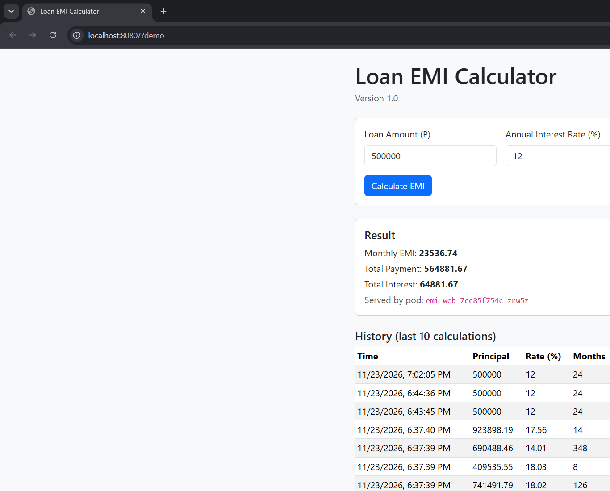
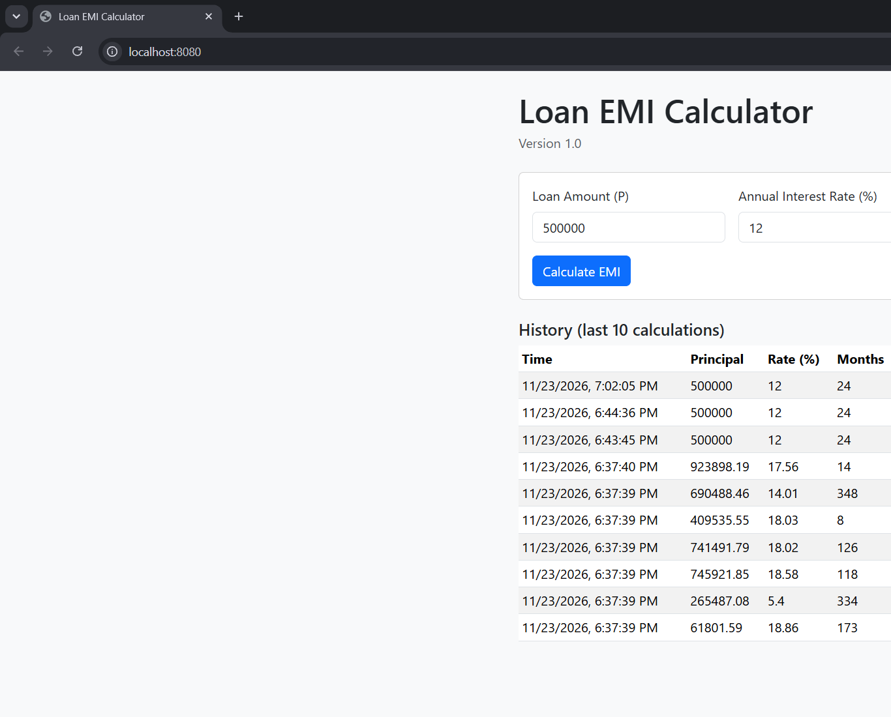
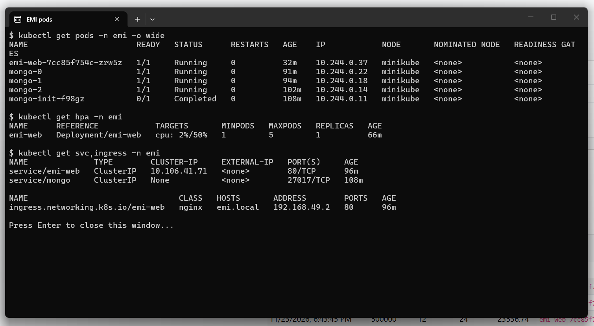
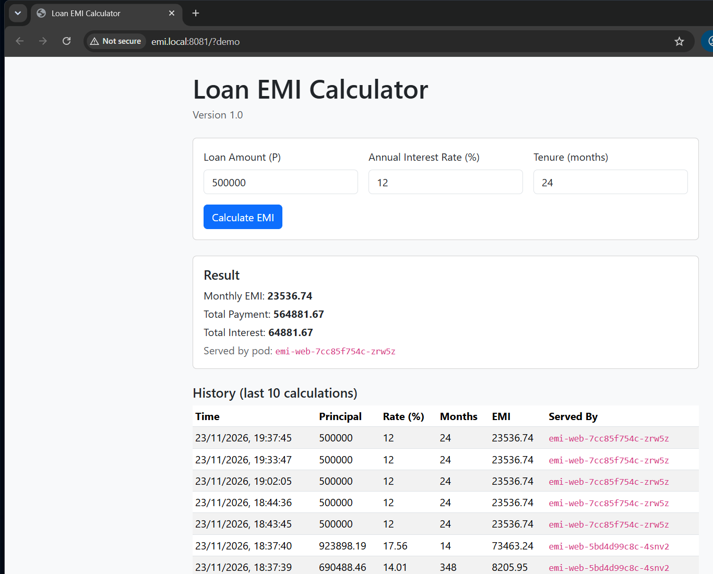
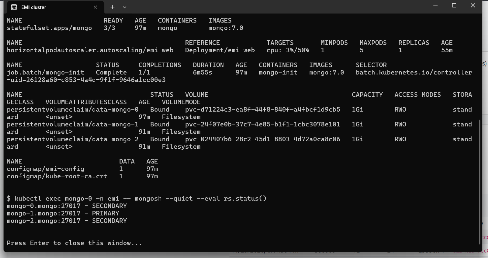
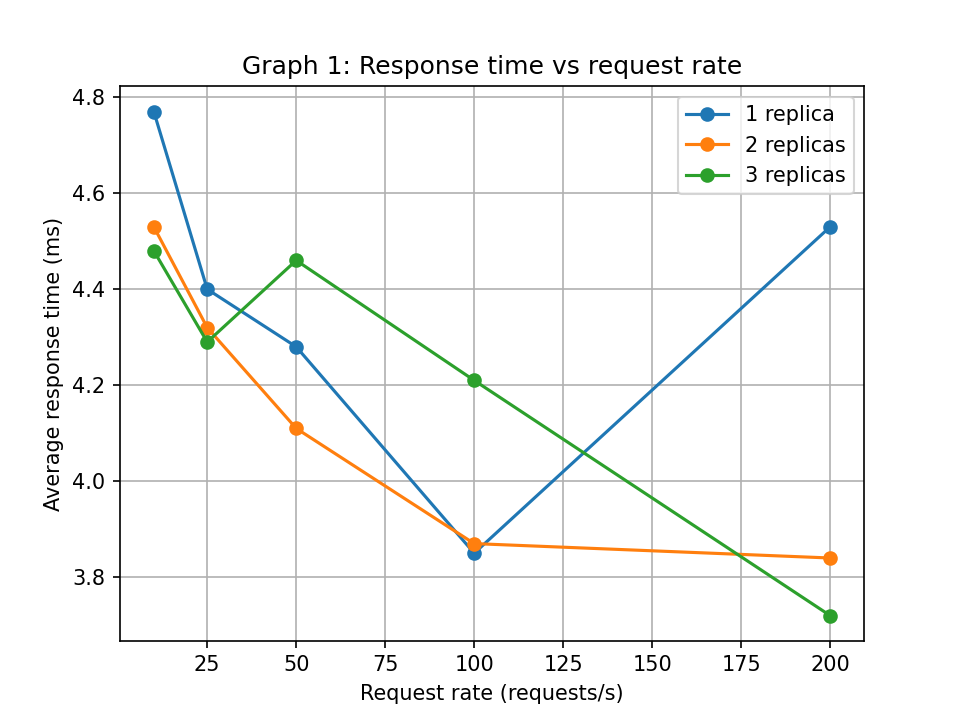
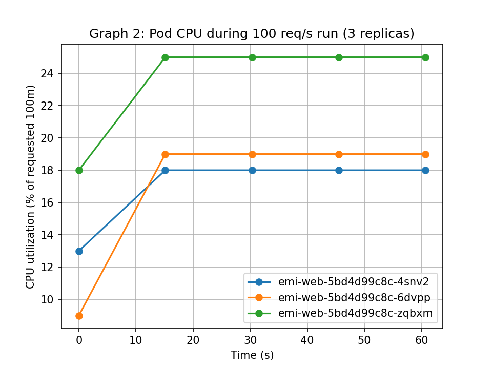
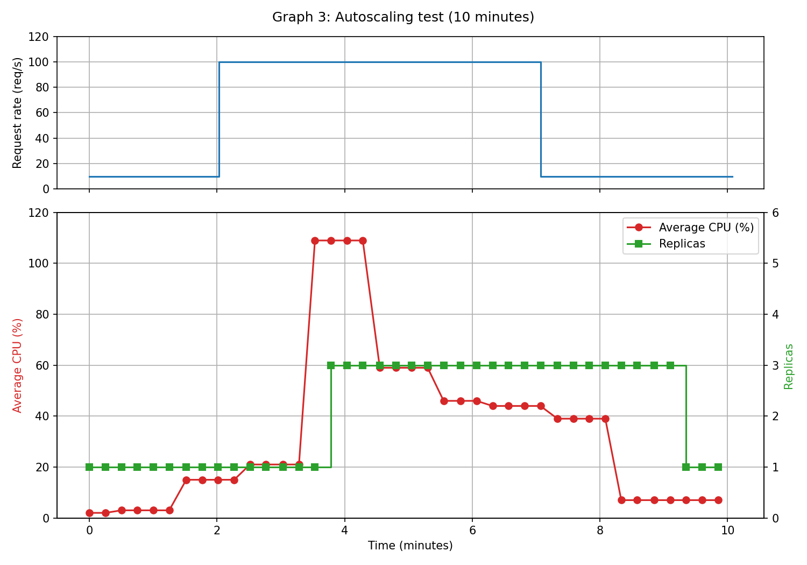

# Assignment 4 – Deploying, Load Balancing and Autoscaling a Web Application with MongoDB on Kubernetes

**Course:** DS-584 Cloud Computing, Fall 2026
**Name:** <your name>  **Roll No:** MSDSF26M001

Git repository: <repo link>

---

## Milestone 01 – Loan EMI Calculator with MongoDB

The app is built with Node.js/Express. The UI is a single page
(`app/public/index.html`) using Bootstrap and jQuery; the form is submitted
with AJAX so only the result panel and history table update.

- `POST /api/emi` – validates inputs, computes the EMI, saves the calculation
  to MongoDB and returns the result plus the pod name (`HOSTNAME`).
- `GET /api/history` – last 10 calculations, newest first.
- `GET /health` – HTTP 200 only when MongoDB is reachable.
- Connection string is read from the `MONGO_URL` environment variable.

**Screenshot of the UI for P=500000, rate=12%, n=24 with the history table:**



Source code: see `app/` (Git repository link above).

---

## Milestone 02 – MongoDB and Web App on Minikube

`Dockerfile` uses `node:20-alpine`, installs dependencies, copies the code and
runs as the built-in non-root `node` user. A `.dockerignore` is included. The
image is built as `emi-web:1.0` inside the Minikube Docker daemon
(`eval $(minikube docker-env)`) and the Deployment uses
`imagePullPolicy: IfNotPresent`.

MongoDB runs as a StatefulSet `mongo` (3 replicas, `mongo:7.0`,
`--replSet rs0 --bind_ip_all`) behind the headless Service `mongo`, with one
1Gi PVC per pod from the `standard` StorageClass. The Job `mongo-init` runs
`mongosh` against `mongo-0.mongo` and calls `rs.initiate()` with the three
members. The connection string is stored in the ConfigMap `emi-config` and
injected as `MONGO_URL`.

### kubectl get all, pvc, configmap -n emi -o wide

```
NAME                           READY   STATUS      RESTARTS   AGE     IP            NODE
pod/emi-web-5bd4d99c8c-cdtrw   1/1     Running     0          75s     10.244.0.15   minikube
pod/emi-web-5bd4d99c8c-fdgc6   1/1     Running     0          75s     10.244.0.17   minikube
pod/emi-web-5bd4d99c8c-xc57w   1/1     Running     0          75s     10.244.0.16   minikube
pod/mongo-0                    1/1     Running     0          13m     10.244.0.12   minikube
pod/mongo-1                    1/1     Running     0          6m58s   10.244.0.13   minikube
pod/mongo-2                    1/1     Running     0          6m57s   10.244.0.14   minikube
pod/mongo-init-f98gz           0/1     Completed   0          13m     10.244.0.11   minikube

NAME              TYPE        CLUSTER-IP     EXTERNAL-IP   PORT(S)     AGE   SELECTOR
service/emi-web   ClusterIP   10.106.41.71   <none>        80/TCP      75s   app=emi-web
service/mongo     ClusterIP   None           <none>        27017/TCP   13m   app=mongo

NAME                      READY   UP-TO-DATE   AVAILABLE   AGE   CONTAINERS   IMAGES        SELECTOR
deployment.apps/emi-web   3/3     3            3           75s   emi-web      emi-web:1.0   app=emi-web

NAME                                 DESIRED   CURRENT   READY   AGE
replicaset.apps/emi-web-5bd4d99c8c   3         3         3       75s

NAME                     READY   AGE   CONTAINERS   IMAGES
statefulset.apps/mongo   3/3     13m   mongo        mongo:7.0

NAME                   STATUS     COMPLETIONS   DURATION   AGE
job.batch/mongo-init   Complete   1/1           6m55s      13m

NAME                                 STATUS   VOLUME                                     CAPACITY   ACCESS MODES   STORAGECLASS   AGE
persistentvolumeclaim/data-mongo-0   Bound    pvc-d71224c3-ea8f-44f8-840f-a4fbcf1d9cb5   1Gi        RWO            standard       13m
persistentvolumeclaim/data-mongo-1   Bound    pvc-24f07e0b-37c7-4e85-b1f1-1cbc3078e101   1Gi        RWO            standard       6m58s
persistentvolumeclaim/data-mongo-2   Bound    pvc-024407b6-28c2-45d1-8803-4d72a0ca8c06   1Gi        RWO            standard       6m57s

NAME                         DATA   AGE
configmap/emi-config         1      13m
configmap/kube-root-ca.crt   1      13m
```

### rs.status() (member names and states) and mongo-init job logs

```
$ kubectl logs job/mongo-init -n emi
{ ok: 1 }
Replica set rs0 is ready:
mongo-0.mongo:27017 SECONDARY
mongo-1.mongo:27017 STARTUP
mongo-2.mongo:27017 STARTUP

$ kubectl exec mongo-0 -n emi -- mongosh --quiet --eval 'rs.status().members.forEach(m => print(m.name, "-", m.stateStr))'
mongo-0.mongo:27017 - PRIMARY
mongo-1.mongo:27017 - SECONDARY
mongo-2.mongo:27017 - SECONDARY
```

(The job log shows the state right after `rs.initiate()` returned ok; a few
seconds later the members settled into one PRIMARY and two SECONDARY.)

**Screenshot of the app through `kubectl port-forward svc/emi-web 8080:80 -n emi` with the history table:**



**Terminal: pods Running, HPA, Services and Ingress (`kubectl get pods/hpa/svc,ingress -n emi`):**



### Persistence test (delete mongo-1)

Pod age before/after, PVC name, document count before and after:

```
=== documents BEFORE deleting mongo-1 ===
4

=== mongo-1 pod and its PVC BEFORE ===
NAME      READY   STATUS    RESTARTS   AGE     IP            NODE
mongo-1   1/1     Running   0          7m10s   10.244.0.13   minikube
NAME           STATUS   VOLUME                                     CAPACITY   ACCESS MODES   STORAGECLASS   AGE
data-mongo-1   Bound    pvc-24f07e0b-37c7-4e85-b1f1-1cbc3078e101   1Gi        RWO            standard       7m10s

=== deleting mongo-1 ===
pod "mongo-1" deleted from emi namespace

=== mongo-1 AFTER re-creation (same name, same PVC, fresh age) ===
NAME      READY   STATUS    RESTARTS   AGE   IP            NODE
mongo-1   1/1     Running   0          29s   10.244.0.18   minikube
NAME           STATUS   VOLUME                                     CAPACITY   ACCESS MODES   STORAGECLASS   AGE
data-mongo-1   Bound    pvc-24f07e0b-37c7-4e85-b1f1-1cbc3078e101   1Gi        RWO            standard       7m56s

=== documents AFTER (no data loss) ===
4
```

The StatefulSet re-created the pod with the same name `mongo-1`, attached the
same PVC `data-mongo-1` (same volume `pvc-24f07e0b-...`), and all 4 documents
were still there.

---

## Milestone 03 – Ingress, Load Balancing and Self-Healing

The Ingress (`k8s/04-ingress.yaml`) uses `ingressClassName: nginx` and routes
`http://emi.local/` to the `emi-web` Service. `emi.local` is mapped to
`minikube ip` in `/etc/hosts` (on Windows/macOS with the Docker driver, run
`minikube tunnel` and map `127.0.0.1` instead; the screenshot below was taken
through the ingress controller).

**Screenshot of the app at http://emi.local:**



**Terminal: StatefulSet, PVCs and `rs.status()` (mongo-1 is PRIMARY after the failover test below):**



### Load distribution (30 requests, `servedBy` count)

With 3 replicas every pod served roughly one third of the traffic. Right
after scaling to 5 the first batch still went only to the 3 old pods; once the
new pods became Ready, the Service spread the traffic across all 5.

| Replicas | Pod | Requests served |
|---|---|---|
| 3 | emi-web-5bd4d99c8c-cdtrw | 10 |
| 3 | emi-web-5bd4d99c8c-fdgc6 | 8 |
| 3 | emi-web-5bd4d99c8c-xc57w | 12 |
| 5 | emi-web-5bd4d99c8c-929jb | 5 |
| 5 | emi-web-5bd4d99c8c-cdtrw | 6 |
| 5 | emi-web-5bd4d99c8c-fdgc6 | 8 |
| 5 | emi-web-5bd4d99c8c-tvdtm | 5 |
| 5 | emi-web-5bd4d99c8c-xc57w | 6 |

### Self-healing

Web pod deleted (`emi-web-...-929jb`): the Deployment immediately created
`...-w2mxp` while all 40 requests through the Ingress returned HTTP 200.

```
emi-web-5bd4d99c8c-w2mxp   0/1     Pending             0     0s
emi-web-5bd4d99c8c-929jb   1/1     Terminating         0     53s
emi-web-5bd4d99c8c-w2mxp   0/1     ContainerCreating   0     0s
emi-web-5bd4d99c8c-w2mxp   0/1     Running             0     1s
emi-web-5bd4d99c8c-w2mxp   1/1     Running             0     7s

request log (40 requests, one every 0.5 s): all HTTP 200, zero failures
(full log in results/m3_selfheal_web_requests.txt)
```

MongoDB PRIMARY (`mongo-0`) deleted: `mongo-1` was elected PRIMARY within
seconds, the StatefulSet re-created `mongo-0` as SECONDARY, and the app kept
saving calculations through the Ingress.

```
=== rs.status() after failover ===
mongo-0.mongo:27017 - SECONDARY
mongo-1.mongo:27017 - PRIMARY
mongo-2.mongo:27017 - SECONDARY

=== app still saves (POST through ingress) ===
{"emi":8008.24,"totalPayment":288296.55,"totalInterest":38296.55,"servedBy":"emi-web-5bd4d99c8c-tvdtm"}

=== document count afterwards ===
135
```

### Rolling update (1.0 -> 1.1) and rollback

`kubectl set image deployment/emi-web emi-web=emi-web:1.1 -n emi` with a
request loop (90 requests) running in parallel:

```
$ kubectl rollout status deployment/emi-web -n emi
Waiting for deployment "emi-web" rollout to finish: 3 out of 5 new replicas have been updated...
...
deployment "emi-web" successfully rolled out

TOTAL FAILED REQUESTS: 0        (all 90 requests returned HTTP 200)

$ kubectl rollout history deployment/emi-web -n emi
REVISION  CHANGE-CAUSE
1         <none>
2         <none>
```

The updated page showed "Version 1.1 - updated release". Then:

```
$ kubectl rollout undo deployment/emi-web -n emi
deployment.apps/emi-web rolled back
$ kubectl rollout status deployment/emi-web -n emi
deployment "emi-web" successfully rolled out
```

After the undo the page showed "Version 1.0" again.

---

## Milestone 04 – Load Testing, Profiling and Autoscaling

All raw outputs are in `results/` (CSV files per run, per-pod and host usage,
HPA timeline). The workload is `POST /api/emi` with random valid inputs sent
through the Ingress by `scripts/loadgen.py`.

### Graph 1 – Average response time vs request rate (1, 2, 3 replicas)



Raw numbers (from `results/summary_fixed.csv`, 60 s per run, 0 errors in all runs):

| Replicas | 10 req/s | 25 req/s | 50 req/s | 100 req/s | 200 req/s |
|---|---|---|---|---|---|
| 1 | 4.77 ms | 4.40 ms | 4.28 ms | 3.85 ms | 4.53 ms |
| 2 | 4.53 ms | 4.32 ms | 4.11 ms | 3.87 ms | 3.84 ms |
| 3 | 4.48 ms | 4.29 ms | 4.46 ms | 4.21 ms | 3.72 ms |

### Graph 2 – Per-pod CPU during the 100 req/s run with 3 replicas



### Graph 3 – Autoscaling test: request rate, average CPU, replicas over 10 minutes



The test started with the HPA steady at 1 replica. When the rate jumped to
100 req/s, the single pod's CPU rose above 100% of its 100m request, so the
HPA scaled the Deployment to 3 pods (`ceil(109/50) = 3`). After the load
dropped back to 10 req/s, the HPA scaled back down to 1 pod. All 60000
requests succeeded (0 errors).

The HPA uses a 60-second `scaleDown.stabilizationWindowSeconds` (instead of
the 5-minute default) so the scale-down is visible inside the 3-minute
cool-down phase.

### HPA timeline (kubectl get hpa every 15 s)

```
 t(min)  replicas  cpu%
  0.00         1     2
  2.02         1    15     <- 10 req/s
  3.53         1   109     <- rate jumps to 100 req/s
  3.78         3   109     <- HPA scales up to 3 pods
  5.05         3    59
  7.07         3    44
  8.33         3     7     <- rate back to 10 req/s
  9.35         1     7     <- HPA scales down to 1 pod
  9.85         1     7
```

(Full timeline in `results/autoscale_hpa.csv`; per-pod and host metrics in
`results/autoscale_pods.csv` and `results/autoscale_host.csv`.)
